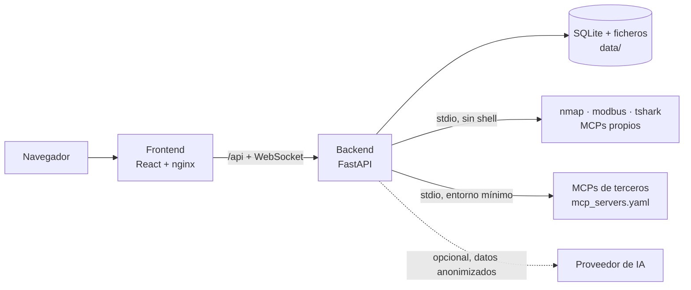

# Audit Platform

Plataforma **local** para gestionar campañas de auditoría de seguridad (OT, IoT, Web, Mobile y Red): define el alcance, analiza capturas de red, lanza herramientas con control de alcance, documenta hallazgos con sus evidencias y genera el informe, con un asistente de IA opcional.

Pensada para **un auditor trabajando en su portátil**: los datos se quedan en tu equipo y nada sale de él salvo que actives el asistente de IA.

> **Uso autorizado.** Esta herramienta lanza escaneos y analiza tráfico. Úsala solo sobre sistemas para los que tengas autorización expresa del propietario. Las herramientas activas piden tu aprobación y se limitan al alcance de la campaña, pero la responsabilidad de la auditoría es tuya.

## Qué hace

- **Campañas y alcance.** Cada campaña define su alcance (IPs, CIDR, hostnames) con validación por línea e historial de cambios. El alcance se comprueba **en código**, nunca solo en el prompt del asistente.
- **Capturas y mapa lógico.** Sube `.pcap`/`.pcapng`: se analizan offline con tshark y se dibuja el mapa de comunicaciones entre activos, que se actualiza en vivo.
- **Contenido de protocolo.** No solo qué protocolo se usa, sino qué se envió en **HTTP, MQTT, Modbus/TCP, S7comm y FTP**: URLs y métodos, topics, funciones y valores, escrituras en PLC, órdenes de parada, comandos de FTP. Las credenciales en claro se marcan como posibles hallazgos.
- **Herramientas.** nmap y lectura Modbus integrados, y soporte para **MCPs de terceros** (incluye [Wireshark-MCP](https://github.com/bx33661/Wireshark-MCP)) declarados en un manifiesto que deniega todo lo que no listes.
- **Hallazgos y evidencias.** Estructura de informe de auditoría, puntuación **CVSS 3.0/3.1 calculada desde el vector**, evidencias en imagen insertables en la prueba de concepto y **creación de un hallazgo en borrador con un clic** desde un evento de captura.
- **Informes.** Word, PDF y Markdown, en español o inglés, con borradores de resumen y conclusiones asistidos por IA que nunca se guardan solos.
- **Asistente de IA (opcional).** Chat por campaña con Claude, DeepSeek, LiteLLM o cualquier API compatible con OpenAI (incluidos modelos locales). Apagado por defecto en cada campaña.

## Cómo encaja



Los servidores MCP se lanzan como subproceso por llamada. Todo lo que el asistente o la interfaz pueden ejecutar pasa antes por una lista de herramientas permitidas y por la validación de alcance.

## Inicio rápido (Docker)

Necesitas Docker con Compose v2.24 o superior.

```bash
git clone <url-del-repositorio> audit-platform
cd audit-platform
docker compose up -d --build
```

Abre **http://127.0.0.1:8080**.

- Los datos (base de datos, capturas, evidencias e informes) viven en `./data`.
- El puerto solo se publica en `127.0.0.1`. **La aplicación no tiene autenticación: no la expongas a la red.**
- Para una imagen mucho más ligera sin exportación a PDF: `WITH_PDF=0 docker compose up -d --build`.
- Si tu usuario no tiene uid 1000, exporta antes `UID` y `GID` para que `./data` sea tuyo.
- Las claves de IA y las variables `AUDIT_LLM_*` se leen de un `.env` opcional (copia `.env.example`). También puedes configurarlas desde la propia interfaz.

> nmap dentro de Docker escanea desde la red del contenedor. Para auditar tu LAN con detección por ARP, ejecuta el backend directamente en el equipo (ver abajo).

## Instalación manual

Requisitos: **Python 3.11+**, **Node 18** (Vite 5 y Tailwind 3.4), `nmap` y `tshark`. Para exportar a PDF, además LibreOffice y el `python3` del sistema con el módulo `uno`.

```bash
# Backend  → http://127.0.0.1:8000
cd backend
python3 -m venv .venv && .venv/bin/pip install -r requirements.txt
.venv/bin/uvicorn app.main:app --host 127.0.0.1 --reload

# Frontend → http://127.0.0.1:5173 (proxy de /api hacia :8000)
cd frontend
npm install && npm run dev
```

Hay una captura sintética de ejemplo en `samples/demo_ot.pcap` para probar el mapa.

## Primeros pasos

1. **Crea una campaña** con su tipo de auditoría y su alcance.
2. **Sube una captura** en *Capturas* o lanza una herramienta en *Herramientas*. Lo que quede fuera de alcance se rechaza.
3. **Revisa el *Mapa***: pulsa un flujo de la tabla para ver qué se envió. Las escrituras, las órdenes de control y las credenciales en claro aparecen resaltadas.
4. **Crea hallazgos**: a mano o con *Crear hallazgo* desde un evento. Nacen en borrador y completas el identificador, el vector CVSS y el resto.
5. **Añade evidencias** (arrastrar, pegar con Ctrl+V o seleccionar) e insértalas en la prueba de concepto con *Insertar Evidencia N*.
6. **Genera el informe** en *Informe*: Word, PDF o Markdown.

## Seguridad y privacidad

Esto es lo que garantiza el diseño y lo que no.

- **Datos locales.** Todo se guarda en `data/`. Solo sale algo del equipo si activas el asistente de IA en una campaña.
- **Alcance en código.** El objetivo de cada herramienta de red se valida contra el alcance al lanzarla desde la interfaz, al proponerla el asistente y de nuevo al aprobarla.
- **Aprobación humana.** Las herramientas activas (las que generan tráfico) nunca se ejecutan sin tu aprobación. Las pasivas que analizan una captura ya subida las ejecuta el asistente sin pedirla, porque son offline.
- **IA apagada por defecto**, por campaña. Con ella activa, lo que se envía al proveedor pasa por una anonimización: IPs, MAC y hostnames se sustituyen por seudónimos (`IP-0001`…) y los secretos por `[REDACTED]`. Los argumentos que devuelve el modelo se restauran antes de validar el alcance y ejecutar. Los eventos de protocolo con credenciales no se exponen al asistente.
- **API local.** Solo acepta los `Host` y `Origin` esperados (protección frente a CSRF y DNS rebinding). Las evidencias solo admiten imágenes raster (sin SVG) y las rutas de fichero quedan confinadas a `data/campaigns/`.
- **Las claves de los proveedores de IA se guardan en texto plano** en la base de datos (permisos `0600`, también en sus copias). La API nunca las devuelve. Protege el directorio `data/` como protegerías las propias claves.
- **Las credenciales en claro de las capturas se muestran tal cual** en la interfaz. En los borradores de hallazgo se enmascaran (`h*****2`).

## Asistente de IA y proveedores

Cada campaña tiene «Permitir LLM» (apagado) y «Anonimizar» (encendido). El proveedor se elige por **perfiles** en *Ajustes → Proveedores de IA* (con un botón «Probar» que no envía datos de campañas) o por variables de entorno del backend:

| Variable | Qué hace |
|---|---|
| `AUDIT_LLM_PROVIDER` | `anthropic` (por defecto), `deepseek`, `litellm` u `openai` (cualquier `/chat/completions`: Ollama, vLLM, OpenAI…) |
| `AUDIT_LLM_MODEL` | Modelo. Por defecto `claude-opus-5-5` / `deepseek-flash`. En LiteLLM, el `model_name` de tu `config.yaml` |
| `AUDIT_LLM_BASE_URL` | DeepSeek: `https://api.deepseek.com` · LiteLLM: `http://localhost:4000` · `openai`: obligatoria (p. ej. `http://localhost:11434/v1`) |
| `AUDIT_LLM_API_KEY` | O la propia del proveedor: `ANTHROPIC_API_KEY`, `DEEPSEEK_API_KEY`, `LITELLM_API_KEY`, `OPENAI_API_KEY` |
| `AUDIT_LLM_EFFORT` | Esfuerzo de razonamiento (`low`…`max`) para Claude y DeepSeek. Por defecto `high` |
| `AUDIT_LLM_MAX_TOKENS` | Salida máxima en proveedores OpenAI-compatibles (8192) |
| `AUDIT_LLM_TOOLS` | `0` para modelos sin soporte de herramientas: el chat solo ve la instantánea inicial |
| `AUDIT_LLM_PASS_REASONING` | Reenviar `reasoning_content` (por defecto solo con `deepseek`; actívalo si LiteLLM apunta a DeepSeek) |
| `AUDIT_LLM_EXTRA_BODY` | JSON que se fusiona en la petición, p. ej. `{"thinking":{"type":"disabled"}}` |

Perfil elegido en la campaña → perfil predeterminado → entorno. La interfaz indica si el servidor es **externo** o **local** (localhost o red privada) al habilitar el LLM. Una conversación no se mezcla entre proveedores: si cambias, pulsa «Nueva conversación».

## MCPs de terceros

Se declaran en [`backend/mcp_servers.yaml`](backend/mcp_servers.yaml). El manifiesto **deniega por defecto**: solo existen las herramientas que listes.

```yaml
servers:
  wireshark:
    command: [/opt/mcp/wireshark/bin/wireshark-mcp, serve]
    tools:
      wireshark_detect_port_scan:    {active: false, capture_arg: pcap_file, allowed_args: [pcap_file, threshold]}
      wireshark_extract_credentials: {active: false, capture_arg: pcap_file, allowed_args: [pcap_file], llm: false}
```

Por herramienta:

| Campo | Significado |
|---|---|
| `active` | `true` genera tráfico hacia un objetivo (siempre con aprobación). `false` es pasiva |
| `allowed_args` | Lista cerrada de argumentos. Rutas de salida, `sudo` o flags crudos se rechazan |
| `target_arg` | Argumento con el objetivo de red, validado contra el alcance |
| `capture_arg` | Argumento con la ruta de una captura: indicas un `capture_id` y la app resuelve la ruta real, siempre dentro de la campaña |
| `llm` | `false` = solo el auditor desde la interfaz, no el asistente (para salidas con payloads o credenciales) |

El servidor externo arranca con un **entorno mínimo** (no ve tus claves), su salida se limita en tamaño, un servidor roto se omite sin afectar a los demás y un manifiesto inválido no se aplica a medias. La imagen Docker instala Wireshark-MCP en un entorno propio con la versión fijada. Se puede usar otro manifiesto con `AUDIT_MCP_MANIFEST`.

## Informes

- **Word, PDF y Markdown**, en español o inglés. La maquetación del Word vive solo en `backend/app/report/docx_builder.py`.
- El PDF se genera con LibreOffice. Word pregunta al abrir si actualizar los campos del índice: di que sí.
- «Borrador con IA» propone resúmenes y conclusiones y nunca los guarda solo.

## Configuración

| Variable | Qué hace |
|---|---|
| `AUDIT_DATA_DIR` | Carpeta de datos (por defecto `./data`). Útil para pruebas aisladas |
| `AUDIT_ALLOWED_HOSTS` | Hosts aceptados por la API (por defecto `127.0.0.1,localhost`) |
| `AUDIT_ALLOWED_ORIGINS` | Orígenes aceptados (por defecto el Vite en `:5173`; en Docker, el puerto 8080) |
| `AUDIT_MCP_MANIFEST` | Ruta de otro manifiesto de MCPs de terceros |
| `API_TARGET` | Destino del proxy de Vite (por defecto `http://127.0.0.1:8000`) |

Al actualizar, el backend añade las columnas nuevas a tu base de datos y antes hace una copia `audit.db.bak-<fecha>` junto al fichero.

## Estructura del repositorio

```
backend/          FastAPI + SQLAlchemy + SQLite (WAL)
  app/              API, asistente (llm/), informes (report/), cliente MCP
  mcp_servers/      MCPs propios (nmap, modbus, tshark) y decodificador de protocolos
  mcp_servers.yaml  manifiesto de MCPs de terceros
  tests/
frontend/         React + TypeScript + Vite 5 + Tailwind 3.4
samples/          captura sintética de ejemplo
docker-compose.yml
```

## Desarrollo y tests

```bash
cd backend && .venv/bin/python -m pytest -q -p no:logging   # más de 150 tests
cd frontend && npm run build                                # tsc + vite
```

Los tests de capturas necesitan `tshark`; el de PDF necesita LibreOffice y `poppler` y se omite si faltan. Cada test usa una base de datos y una carpeta temporales; el asistente se prueba con un LLM simulado, sin red ni claves.

## Limitaciones conocidas

- **Proveedores de IA reales.** La cobertura automática usa dobles; las llamadas reales a cada proveedor dependen de tu entorno.
- **Protocolos.** Solo se interpretan los puertos estándar (80, 1883, 502, 102 y 21). No se reensamblan los cuerpos HTTP ni los canales de datos FTP, y los eventos se agrupan por flujo y operación (máximo 300 distintos por flujo).
- **CVSS 4.0** no se calcula: la puntuación se introduce a mano. 3.0 y 3.1 se calculan desde el vector.
- **Mapa de nivel 2** (ARP, LLDP, PROFINET): los paquetes sin capa IP se cuentan pero no se dibujan.
- **Sin autenticación ni multiusuario**, por diseño: es una herramienta local de una sola persona.
- Sin Alembic: las columnas nuevas se añaden con una migración mínima propia.

## Créditos

- Los presets de tema Neutro, Soft Pop, Tangerine y Brutalist están adaptados de «Studio Admin» (arhamkhnz, licencia MIT).
- [Wireshark-MCP](https://github.com/bx33661/Wireshark-MCP) (MIT) se usa como ejemplo de servidor de terceros.
- Componentes de interfaz al estilo [shadcn/ui](https://ui.shadcn.com), con Radix UI, Tailwind CSS, Recharts y Cytoscape.js.
